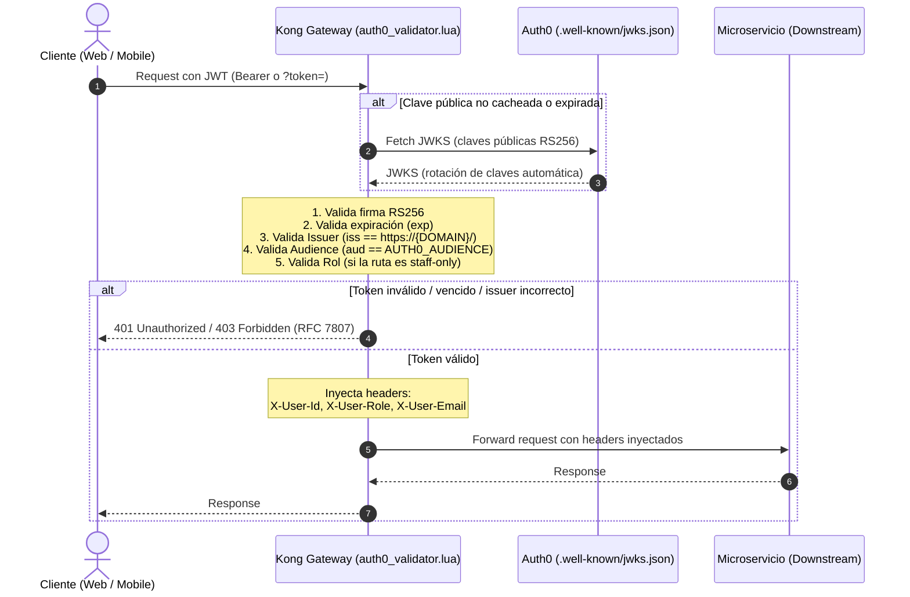

## 1. Arquitectura y Configuración del Gateway

El Gateway está configurado siguiendo el patrón **GitOps / Configuration as Code** en modo **DB-less (declarativo)**, documentado en el [ADR-001](file:///Users/pilarmontilla/Desktop/ids2/discordia-orchestrator/Gateway/docs/ADR-001-API-Gateway.md). No depende de una base de datos relacional (como PostgreSQL) para almacenar rutas, lo que elimina complejidad operacional y puntos de fallo.

### Componentes clave

1. **Kong 3.4 DB-less:**
   - La topología completa de servicios, rutas y plugins está declarada en [`kong.yml`](file:///Users/pilarmontilla/Desktop/ids2/discordia-orchestrator/Gateway/kong.yml).
   - Corre en un contenedor Docker orquestado en [`Gateway/docker-compose.yml`](file:///Users/pilarmontilla/Desktop/ids2/discordia-orchestrator/Gateway/docker-compose.yml) conectado a la red interna `discordia-net`.
2. **Redis 7:**
   - Instancia compartida utilizada como almacén centralizado para el plugin de **Rate Limiting**.
3. **Plugins Globales** (aplicados a todo el tráfico entrante en [`kong.yml`](file:///Users/pilarmontilla/Desktop/ids2/discordia-orchestrator/Gateway/kong.yml#L152-L172)):
   - **`cors`**: Permite orígenes autorizados (`https://app.discordia.com` y `http://localhost:5173`) y expone encabezados de trazabilidad.
   - **`rate-limiting`**: Límite global de 300 peticiones por minuto por IP respaldado en Redis.
   - **`correlation-id`**: Genera o propaga `X-Correlation-ID` (UUID) para rastreo distribuido de logs entre servicios.
   - **`request-size-limiting`**: Restringe payloads a un máximo de 50 MB.
4. **Mapeo de Microservicios Upstream:**
   - **`auth-user-service`** (`http://auth-service:8000`): Rutas de perfiles de usuario (`/api/v1/users`).
   - **`chat-engine-service`** (`http://chat-service:3000`): REST (`/api/v1/messages`) y WebSockets (`/ws/chat`) con timeouts extendidos (1 hora).
   - **`voice-signaling-service`** (`http://voice-service:3001`): REST (`/api/v1/voice`) y WebSockets (`/ws/voice`).
   - **`server-core-service`** (`http://server-core:8001`): Canales, roles, servidores y moderación.
   - **`payments-service`** (`http://payments-service:8002`): Con rate limiting estricto adicional de 20 peticiones/minuto.
   - **`notification-audit-service`** (`http://notification-service:8003`): Notificaciones, status público (`/api/v1/status`) y rutas restringidas (`/api/v1/audit`, `/api/v1/metrics`).
   - **`api-gateway-self`**: Provee endpoints propios de salud ([`gateway_health.lua`](file:///Users/pilarmontilla/Desktop/ids2/discordia-orchestrator/Gateway/gateway_health.lua)): `/livez` (liveness) y `/readyz` (readiness verificando ping a Redis).

---

## 2. Integración en Profundidad con Auth0

### El Desafío: Kong Community Edition vs. OIDC
El plugin nativo `openid-connect` de Kong solo está disponible en **Kong Enterprise**. Para no depender de plugins de terceros poco mantenidos ni exponer el backend a la gestión de contraseñas/credenciales, se optó por:
1. Delegar el 100% de la gestión de identidad a **Auth0** (registro, login, MFA, revocación, etc.).
2. Construir un módulo validador propio y liviano en Lua: [`auth0_validator.lua`](file:///Users/pilarmontilla/Desktop/ids2/discordia-orchestrator/Gateway/auth0_validator.lua), apoyado en la librería de referencia [`lua-resty-openidc`](https://github.com/zmartzone/lua-resty-openidc), instalado en el [`Dockerfile`](file:///Users/pilarmontilla/Desktop/ids2/discordia-orchestrator/Gateway/Dockerfile).

---

### Flujo Criptográfico y Validación de Tokens (RS256 + JWKS)

La validación es completamente **stateless** y no requiere secretos compartidos (`client_secret`):

#### 1. Verificación de Firma y Rotación de Claves (JWKS)
En [`auth0_validator.lua`](file:///Users/pilarmontilla/Desktop/ids2/discordia-orchestrator/Gateway/auth0_validator.lua#L68-L75):
- Auth0 firma los tokens usando **RS256** con su clave privada.
- El Gateway consulta las claves públicas en:
  `https://{AUTH0_DOMAIN}/.well-known/jwks.json`.
- En [`nginx/shared-dicts.conf`](file:///Users/pilarmontilla/Desktop/ids2/discordia-orchestrator/Gateway/nginx/shared-dicts.conf), se declaran las zonas de memoria compartida de Nginx (`discovery` y `jwks` de 1MB). Esto permite cachear las claves por 1 hora (`jwk_expires_in = 3600`) en memoria RAM compartida entre workers de Nginx. De este modo, no se genera tráfico HTTP innecesario hacia Auth0 y se tolera indisponibilidad temporal del proveedor. Si Auth0 rota claves (`kid`), `lua-resty-openidc` las renueva automáticamente.

#### 2. Chequeo de Issuer (`iss`) y Audience (`aud`)
- **`iss`**: Se valida explícitamente en Lua ([`auth0_validator.lua#L80-L82`](file:///Users/pilarmontilla/Desktop/ids2/discordia-orchestrator/Gateway/auth0_validator.lua#L80-L82)) contra `https://${AUTH0_DOMAIN}/`.
- **`aud`**: Se verifica que coincida con `AUTH0_AUDIENCE` ([`auth0_validator.lua#L88-L99`](file:///Users/pilarmontilla/Desktop/ids2/discordia-orchestrator/Gateway/auth0_validator.lua#L88-L99)). Esto es indispensable: Auth0 solo genera access tokens JWT válidos si la aplicación cliente solicita expresamente el identificador de la API (de lo contrario, emite tokens opacos pensados solo para UserInfo).

#### 3. Soporte Dual de Extracción de Token (REST vs WebSockets)
En [`extract_bearer_token`](file:///Users/pilarmontilla/Desktop/ids2/discordia-orchestrator/Gateway/auth0_validator.lua#L33-L47):
- **Rutas REST**: Se exige estrictamente el header HTTP `Authorization: Bearer <token>`.
- **Rutas WebSocket (`/ws/chat`, `/ws/voice`)**: La API WebSocket estándar del navegador no permite inyectar headers personalizados durante el handshake inicial. Por ende, la ruta en `kong.yml` pasa el flag `allow_query_arg = true` (`validate(nil, true)`), permitiendo leer el token desde la query string (`?token=`). En rutas REST ordinarias, la query string está desactivada para prevenir filtraciones de credenciales en logs de acceso o encabezados `Referer`.

---

### Inyección de Identidad y RBAC Hacia el Backend

Una vez validado el token, el Gateway se encarga de aislar al backend del mecanismo de autenticación:

1. **Claims Custom vía Auth0 Actions:**
   - En Auth0, los access tokens para APIs no incluyen por defecto claims como `email` ni roles internos del sistema a menos que se inyecten en el flujo de login (Auth0 Actions).
   - Se utilizan claims namespaced:
     - Rol: `https://discordia.app/role` (configurable vía `AUTH0_ROLE_CLAIM`).
     - Email: `https://discordia.app/email` (configurable vía `AUTH0_EMAIL_CLAIM`).
2. **Autorización basada en roles (RBAC en el Gateway):**
   - En [`kong.yml`](file:///Users/pilarmontilla/Desktop/ids2/discordia-orchestrator/Gateway/kong.yml#L125), rutas sensibles como `/api/v1/audit` y `/api/v1/metrics` ejecutan `validate("staff", false)`. Si el claim no es `"staff"`, el Gateway rechaza con **`403 Forbidden`** usando el estándar RFC 7807 (`application/problem+json`).
3. **Propagación de Headers Sanitizados:**
   [`auth0_validator.lua#L119-L125`](file:///Users/pilarmontilla/Desktop/ids2/discordia-orchestrator/Gateway/auth0_validator.lua#L119-L125) inyecta en la petición hacia el microservicio:
   - **`X-User-Id`**: El identificador de Auth0 (claim `sub`, ej. `auth0|64f...`).
   - **`X-User-Email`**: El correo del usuario.
   - **`X-User-Role`**: El rol verificado (`user` o `staff`).

Gracias a esto, servicios downstream como [`Auth-User-Service`](file:///Users/pilarmontilla/Desktop/ids2/discordia-orchestrator/Auth-User-Service/app/api/deps.py#L16-L24) simplemente consumen la dependencia `get_authenticated_identity()` leyendo `X-User-Id` y `X-User-Email`, sin necesidad de comunicarse con Auth0 ni manipular criptografía JWT.

---

### Configuración de Variables de Entorno y Nginx

Para que OpenResty y Lua puedan acceder a las variables y comunicarse con Auth0 de forma segura en Docker:
- [`nginx/main-env.conf`](file:///Users/pilarmontilla/Desktop/ids2/discordia-orchestrator/Gateway/nginx/main-env.conf): Declara directivas `env AUTH0_DOMAIN;`, etc., permitiendo que Nginx no limpie estas variables de entorno en los worker processes.
- [`Gateway/docker-compose.yml`](file:///Users/pilarmontilla/Desktop/ids2/discordia-orchestrator/Gateway/docker-compose.yml#L12-L14):
  - `KONG_UNTRUSTED_LUA_SANDBOX_REQUIRES`: Habilita la importación en sandbox de `auth0_validator`, `gateway_health` y `resty.openidc`.
  - `KONG_LUA_SSL_TRUSTED_CERTIFICATE`: Configura los certificados CA (`/etc/ssl/certs/ca-certificates.crt`) requeridos para validar las conexiones HTTPS salientes hacia el dominio de Auth0.